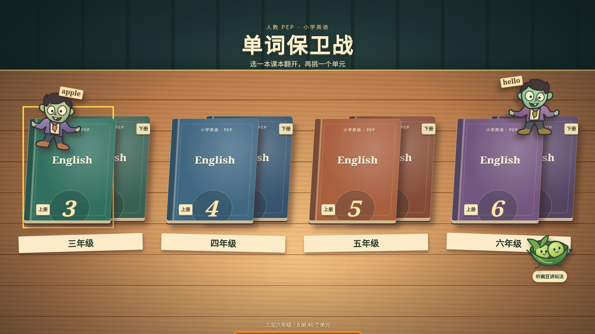
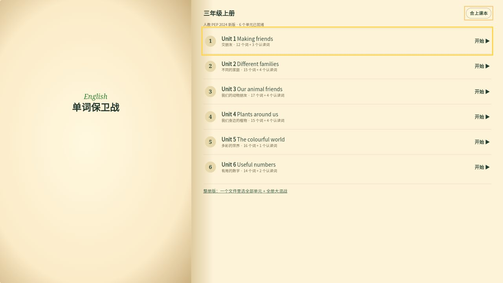
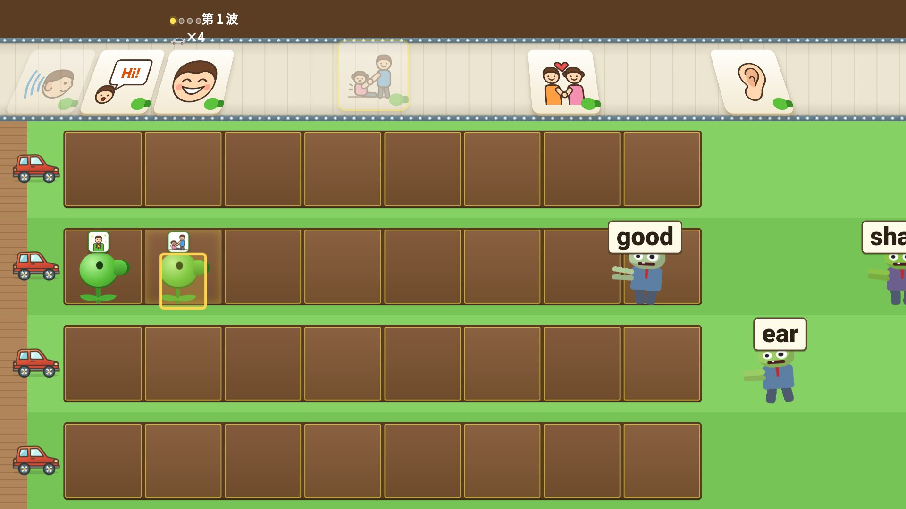
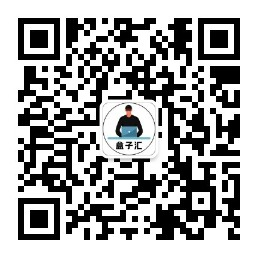

# 单词保卫战 · 人教版小学英语

> 课堂即玩的英语单词对战游戏：选一本书、翻一个单元，把单词卡种进田里，守住四辆小车。
> 覆盖人教版 PEP 三至六年级 8 册 46 个单元；另有网页版与 Android TV 版。

[在线体验网页版](https://niannianweike.top/tools/word-defense/)



## 功能亮点

- **按课本组织**：8 册书、46 个单元独立入口，老师上课点开对应单元即可开玩。
- **玩法还原经典塔防**：传送带掉落单词卡，选中后种到田里；举词僵尸从右侧来袭，种下对应单词的植物才能击退它。
- **完整词库与配音**：全部单词离线内置，`audio/` 提供 863 个 MP3 发音，点卡片/单词即可听读音。
- **认读模式**：先认一认再上战场，认读词只认不考；支持看家谱认亲戚（词族归纳）。
- **难度与提示**：慢慢来 / 正常 / 挑战三档速度；错词加速、卡关自动提示、头盔僵尸等机制。
- **跨册大混战**：把 8 册单词合并为一本虚拟书，打一场混合大乱斗（952 词，545 对战词）。
- **多端适配**：普通浏览器、手机横屏、Android 4.4 及以上电视/盒子（遥控器操作）。

## 界面预览

| 课本选单元 | 对战现场 |
|---|---|
|  |  |

## Android TV 版

针对电视/机顶盒提供独立 APK，支持 Android 4.4（API 19）及以上，遥控器即可完成全部操作。

- 主界面右上角「关于 / 关注我们」，方向键选中、确定键打开二维码。
- 方向键移动焦点，确定键拿起/放置植物，返回键弹出「暂停 / 继续 / 退出」菜单。
- 固定 1920×1080 舞台自适应缩放，任意电视分辨率都能完整显示。
- 已打包全部单词、插图与 863 个离线发音，无需联网。

### 自己构建 TV APK

在 `tv/` 目录：

```sh
cd tv
npm install --prefix tools        # 首次：安装 Babel / PostCSS
node tools/transform.js           # 转译原网页到 assets/tv（ES5 + CSS2）
bash build-apk.sh                 # 用本机 Android SDK 构建签名 APK
```

产物为 `tv/word-defense-tv.apk`。构建脚本使用 Android SDK 的 `aapt2 / javac / d8 / zipalign / apksigner`，不依赖 Gradle。源码在 `tv/android/`（WebView 壳），遥控适配与 4.4 兼容层在 `tv/tools/static/`。

## 网页版本地运行

用浏览器打开根目录 `index.html`，或启动静态服务器：

```sh
python -m http.server 8000
```

然后访问 `http://localhost:8000`。无需安装依赖或构建。各单元独立入口为根目录的 `X年级X册-UnitN-*.html`，`三年级上册-整册版.html` 支持选单元和全册大混战。

## 文件结构

| 路径 | 用途 |
|---|---|
| `index.html` / `desk.css` / `desk.js` | 网页版总入口（课本选单 + 玩法讲解） |
| `game.css` / `game.js` | 网页版所有单元页共用样式与核心引擎 |
| `phone-orientation.css` / `phone-orientation.js` | 手机竖屏暂停与横屏提示 |
| `words.js` / `word-icons.js` | 八册单词表与单词 SVG 插图 |
| `audio/` | 离线单词配音与 `audio/manifest.js` |
| `tv/` | Android TV 版：原生壳、转译脚本、兼容层与 APK |
| `docs/images/` | 本 README 使用的截图与二维码 |

## 关注公众号：盒子汇

扫码关注「盒子汇」，获取更多英语学习资源与课件更新：

<p align="center">
  
</p>

<p align="center">微信公众号：<b>盒子汇</b></p>

## 项目许可

在保留署名和许可说明的前提下，可为非商业目的使用、修改和分享项目的源码与原创课件。学校、培训机构及其他组织将课件用于收费培训、付费课程或其他收费服务，须事先取得书面许可。详见[非商业使用许可](LICENSE.md)。

## 第三方素材

- 单词表依据人教版小学英语教材整理，教材内容著作权归原权利人所有。
- 单词与引导配音使用豆包语音合成。
